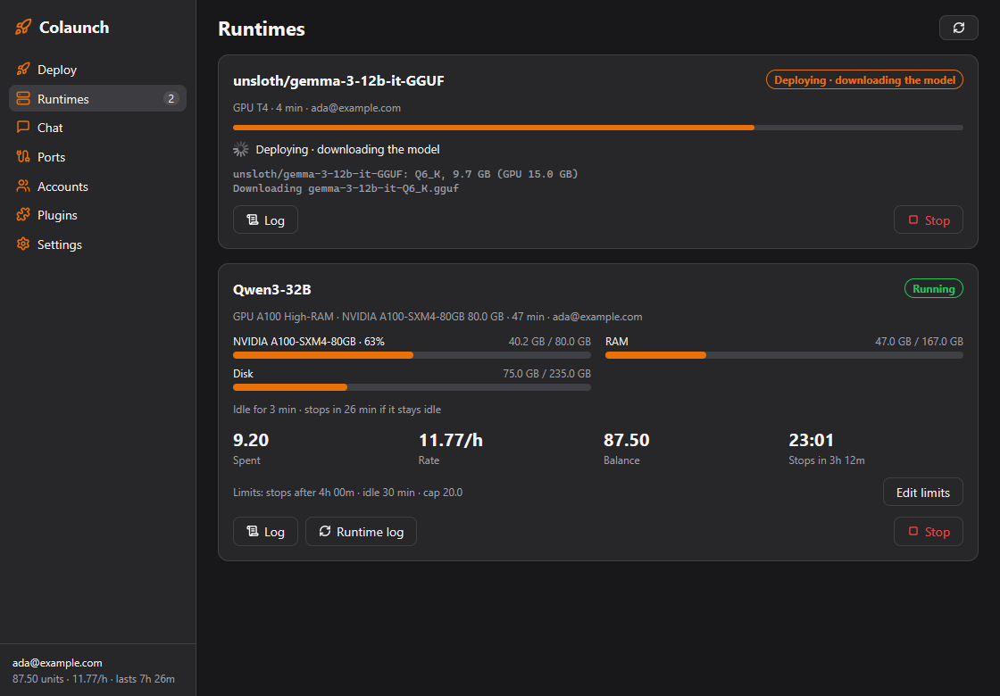
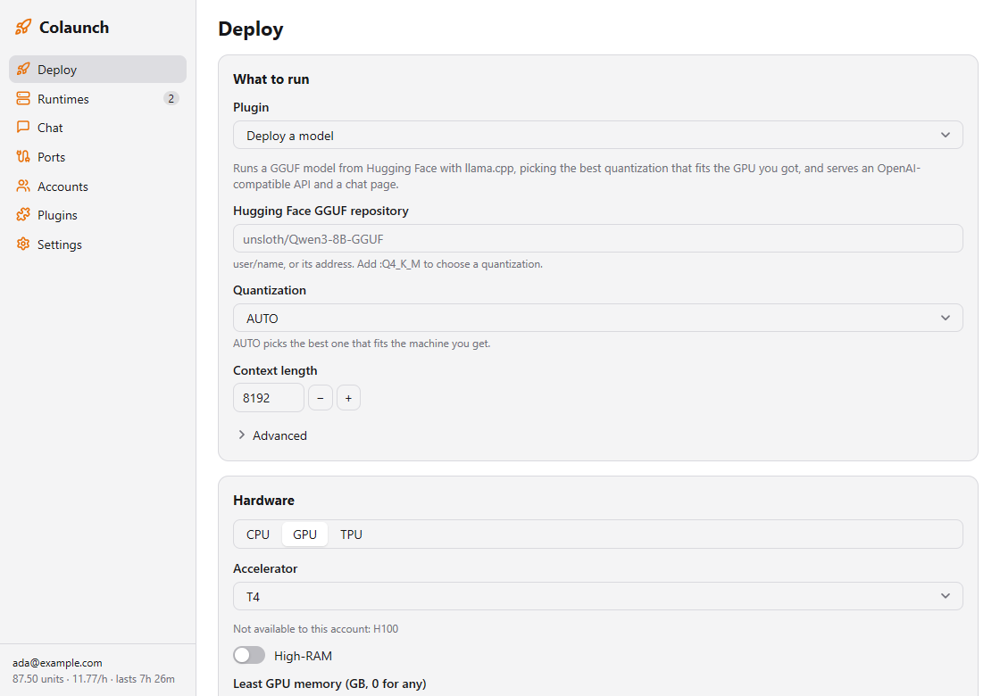
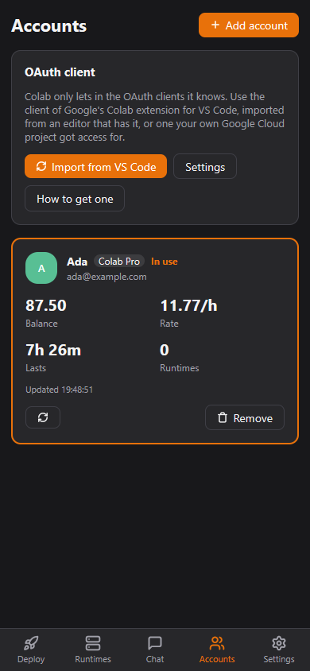

<div align="center">


# Colaunch

**Run models on Google Colab's GPUs from your desktop and your phone.**

Windows · macOS · Linux · Android · iOS — one small native app, written in Go with [MyGo](https://mygo.run)

English · [简体中文](README.zh-CN.md)

[](https://github.com/VOfficial404/colaunch/actions/workflows/test.yml)
[](https://github.com/VOfficial404/colaunch/releases/latest)
[](LICENSE)


</div>

## What it does

- 🚀 **One-click model deployment** — paste a Hugging Face GGUF repository and Colaunch gets a Colab GPU, runs the model with llama.cpp, and hands you an **OpenAI-compatible API** and a **web chat**. It looks at the GPU it actually got and picks **the best quantization that fits**, KV cache included.
- 🖥 **Any hardware** — CPU, GPU, TPU, High-RAM. Set **the least GPU memory** you'll take: an A100 comes with 40 or 80 GB at random, and one with too little is given back and another assigned, automatically.
- 🎯 **Grab a GPU when there are none** — Colab often has nothing to give: Colaunch keeps asking, round after round, falls back to the other accelerators you tick, and can rotate through your other accounts. A desktop notification tells you once it got one.
- 💰 **Cost protection** — stop on a schedule and when idle, **enforced on the runtime itself so they hold with the app closed**; plus a spending cap and a balance floor. Balance, burn rate and how long it lasts, live.
- 👥 **Several Google accounts** — manage them together, switch any time, see every account's balance.
- 🔌 **Port forwarding** — any port of the runtime on your `127.0.0.1`, through Colab's own connection: no ngrok, no cloudflared, nothing public.
- 🧩 **Plugins** — deploying a model is just the built-in plugin. Write your own as a `plugin.json` and a bash script ([docs](docs/plugins.md)).
- 🌏 English, 简体中文, 繁體中文 · light and dark.

<p align="center">


</p>

## Download

Get the app for your system from the [latest release](https://github.com/VOfficial404/colaunch/releases/latest):

| System | File |
|---|---|
| Windows 10/11 (x64, ARM64) | `colaunch-setup-*.exe` |
| macOS 13+ (Apple Silicon, Intel) | `colaunch-*.dmg` |
| Linux (x64, ARM64) | `.deb`, `.rpm`, `.AppImage` or `.tar.gz` |
| Android 8+ | `.apk` |
| iOS 17+ | `.ipa`, for sideloading with AltStore, SideStore, Sideloadly or TrollStore |

The desktop apps update themselves.

## Getting started

1. **Set an OAuth client.** Colab only lets in the OAuth clients it knows: see [docs/oauth.md](docs/oauth.md). On a desktop with Google's [Colab extension for VS Code](https://marketplace.visualstudio.com/items?itemName=Google.colab) installed (or Cursor, Windsurf, Antigravity), **Accounts → Import from VS Code** does it in one click.
2. **Add a Google account** under Accounts, and sign in in the browser. Add as many as you like.
3. **Deploy.** Type a repository, as `unsloth/Qwen3-8B-GGUF`, pick the hardware and the limits, and press **Launch**.
4. When it's ready, the runtime's card shows the API's address — `http://127.0.0.1:8080/v1` — the model's name, and a button to open the web chat. Or chat in the app.

```sh
curl http://127.0.0.1:8080/v1/chat/completions \
  -H "Content-Type: application/json" \
  -d '{"model": "Qwen3-8B", "messages": [{"role": "user", "content": "Hello!"}]}'
```

Any OpenAI client works: set its base URL to `http://127.0.0.1:8080/v1`.

## How it works

```
 your machine                                   Colab runtime
┌──────────────────────────┐   HTTPS/WSS    ┌────────────────────────────────┐
│ Colaunch                 │ ─────────────▶ │ Colab's proxy                  │
│  ├ Colab API: assign,    │                │  └ /colab/tty  (a terminal)    │
│  │   unassign, balance   │                │      ├ agent.py mux ◀──┐       │
│  ├ 127.0.0.1:8080 ◀──────┼── tunnel ──────┼──────┘   llama-server :8765    │
│  └ in-app chat           │                │      └ agent.py watchdog       │
└──────────────────────────┘                └────────────────────────────────┘
```

- Colaunch uses the same Colab endpoints as Google's own [Colab extension for VS Code](https://github.com/googlecolab/colab-vscode): it assigns and unassigns runtimes, and reads the account's compute units.
- On the runtime it opens Colab's terminal and puts a small agent there (`internal/agent/agent.py`, standard library only). The agent tunnels TCP connections over the terminal, so ports reach `127.0.0.1` without anything public.
- The agent's **watchdog** stops the runtime at the time you set, when it has been idle, and when the budget runs out at the account's rate, by asking Colab to unassign it as `google.colab.runtime.unassign()` does. It runs on the runtime, so it holds with the app closed, the laptop asleep or the phone off.
- The llama plugin downloads a prebuilt llama.cpp for CUDA ([built by this repository](.github/workflows/llama-cuda.yml)), or builds it when that doesn't run, and the GGUF files, then serves them with `llama-server`.

More in [docs/architecture.md](docs/architecture.md).

## Build

You need Go 1.27 or later. Desktop builds need nothing else; Android needs the Android SDK and iOS needs Xcode.

```sh
git clone https://github.com/VOfficial404/colaunch
cd colaunch
go tool mygo dev          # run it, rebuilding as you edit
go test ./...             # tests, the views included
go tool mygo build        # package it for this machine
go tool mygo build -platform android
```

Builds can come with an OAuth client, so users needn't set one:

```sh
MYGO_LDFLAGS="-X colaunch/internal/core.defaultClientID=… -X colaunch/internal/core.defaultClientSecret=…" go tool mygo build
```

## Notes

- Colaunch is not affiliated with Google. Colab's [terms](https://research.google.com/colaboratory/tos_v5.html) and [limitations](https://research.google.com/colaboratory/faq.html#limitations-and-restrictions) apply to what you run.
- Compute units cost money. The limits help, but check the balance Colab shows too.
- Refresh tokens stay in the system's keychain (Keychain, Credential Manager, Secret Service).

## License

[MIT](LICENSE). Icons from [Lucide](https://lucide.dev) (ISC).
