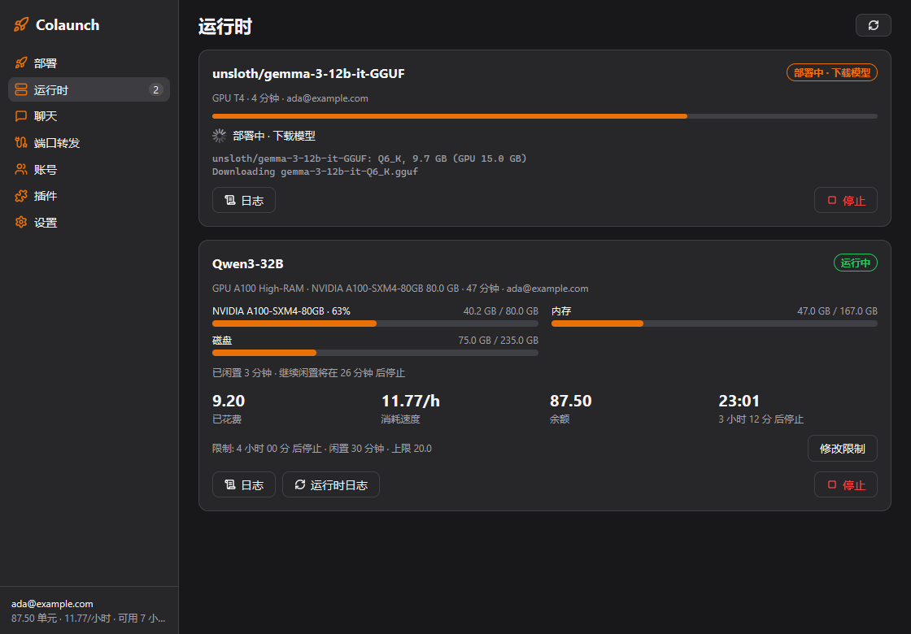
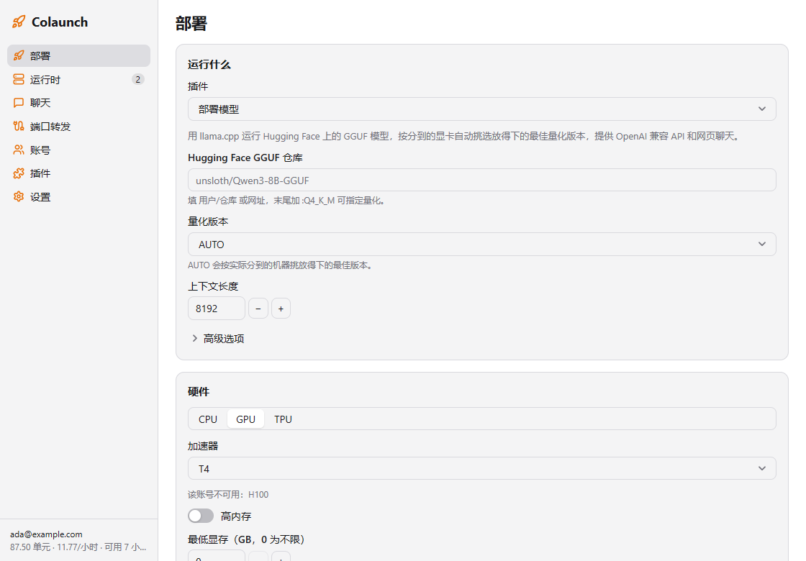
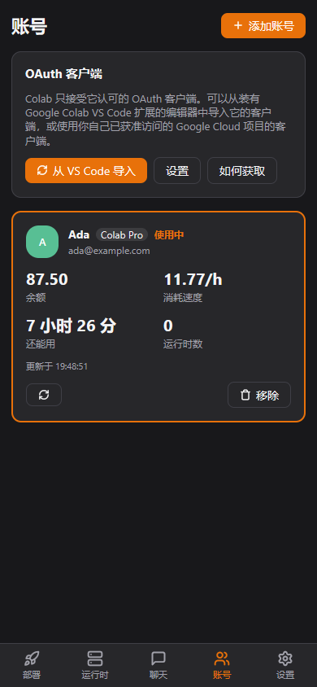

<div align="center">


# Colaunch

**在桌面和手机上，一键把模型跑到 Google Colab 的 GPU 上。**

Windows · macOS · Linux · Android · iOS —— 一个小巧的原生应用，用 Go 和 [MyGo](https://mygo.run/zh) 编写

[English](README.md) · 简体中文

[](https://github.com/VOfficial404/colaunch/actions/workflows/test.yml)
[](https://github.com/VOfficial404/colaunch/releases/latest)
[](LICENSE)


</div>

## 功能

- 🚀 **一键部署模型**：填一个 Hugging Face 的 GGUF 仓库，自动在 Colab GPU 上用 llama.cpp 跑起来，直接给你 **OpenAI 兼容 API** 和**网页聊天**；还会按实际分到的显卡，自动挑**放得下的最佳量化版本**（连 KV cache 一起算）。
- 🖥 **硬件随便选**：CPU、GPU、TPU、高内存，还能设**最低显存**——A100 会随机给 40 GB 或 80 GB，不够就自动退掉重试。
- 🎯 **抢卡**：Colab 经常没卡可分时，自动一轮一轮重试，按顺序尝试你勾选的备选加速器，还能轮换你的其他账号；抢到后弹系统通知。
- 💰 **费用保护**：定时自动停止和闲置停止，**由运行时自己执行，关掉应用也照样生效**；另外还有花费上限和余额下限。余额、消耗速度、还能用多久，实时显示。
- 👥 **多个 Google 账号**：一起管理，随时切换，每个账号的余额都看得到。
- 🔌 **端口转发**：把运行时上的任意端口接到本机 `127.0.0.1`，走 Colab 自己的连接——不用 ngrok、cloudflared，也不会暴露到公网。
- 🧩 **插件**：部署模型只是自带的一个插件，也可以自己写：一个 `plugin.json` 加一个 bash 脚本就行（[文档](docs/plugins.md)）。
- 🌏 简体中文、繁體中文、English，浅色 / 深色。

<p align="center">


</p>

## 下载

到 [最新版本](https://github.com/VOfficial404/colaunch/releases/latest) 下载对应系统的安装包：

| 系统 | 文件 |
|---|---|
| Windows 10/11（x64、ARM64） | `colaunch-setup-*.exe` |
| macOS 13+（Apple 芯片、Intel） | `colaunch-*.dmg` |
| Linux（x64、ARM64） | `.deb`、`.rpm`、`.AppImage` 或 `.tar.gz` |
| Android 8+ | `.apk` |
| iOS 17+ | `.ipa`，用 AltStore、SideStore、Sideloadly 或 TrollStore 侧载 |

桌面版会自动更新。

## 快速上手

1. **设置 OAuth 客户端**。Colab 只接受它认可的 OAuth 客户端，详见 [docs/oauth.md](docs/oauth.md)。如果电脑上的 VS Code（或 Cursor、Windsurf、Antigravity）装了 Google 官方的 [Colab 扩展](https://marketplace.visualstudio.com/items?itemName=Google.colab)，在「账号 → 从 VS Code 导入」点一下即可。
2. 在「账号」页**添加 Google 账号**，在浏览器里完成登录。想加几个加几个。
3. **部署**：填仓库名，比如 `unsloth/Qwen3-8B-GGUF`，选好硬件和费用限制，点「一键部署」。
4. 就绪后，运行时卡片上会显示 API 地址 `http://127.0.0.1:8080/v1`、模型名，以及打开网页聊天的按钮；也可以直接在应用里聊天。

```sh
curl http://127.0.0.1:8080/v1/chat/completions \
  -H "Content-Type: application/json" \
  -d '{"model": "Qwen3-8B", "messages": [{"role": "user", "content": "你好！"}]}'
```

任何 OpenAI 客户端都能用：把 Base URL 设为 `http://127.0.0.1:8080/v1` 即可。

## 原理

```
 你的电脑 / 手机                                  Colab 运行时
┌──────────────────────────┐   HTTPS/WSS    ┌────────────────────────────────┐
│ Colaunch                 │ ─────────────▶ │ Colab 代理                     │
│  ├ Colab API：分配、     │                │  └ /colab/tty（终端）          │
│  │   释放、查余额        │                │      ├ agent.py mux ◀──┐       │
│  ├ 127.0.0.1:8080 ◀──────┼──── 隧道 ──────┼──────┘   llama-server :8765    │
│  └ 应用内聊天            │                │      └ agent.py watchdog       │
└──────────────────────────┘                └────────────────────────────────┘
```

- Colaunch 使用的是 Google 官方 [Colab VS Code 扩展](https://github.com/googlecolab/colab-vscode) 同款接口：分配、释放运行时，读取账号的计算单元。
- 它通过 Colab 的终端在运行时上放一个小 agent（`internal/agent/agent.py`，只依赖 Python 标准库）。agent 把 TCP 连接复用在终端里传输，所以端口能接到 `127.0.0.1`，不需要任何公网暴露。
- agent 的**看门狗**会在设定的时间、闲置超时、以及按当前消耗速度算出预算用尽时，像 `google.colab.runtime.unassign()` 那样让 Colab 回收运行时。它跑在运行时上，所以应用关了、电脑睡了、手机关机了都照样生效。
- llama 插件优先下载[本仓库预编译](.github/workflows/llama-cuda.yml)的 CUDA 版 llama.cpp（不能用时自动现场编译），再下载 GGUF 文件，用 `llama-server` 提供服务。

详见 [docs/architecture.md](docs/architecture.md)。

## 从源码构建

需要 Go 1.27 及以上。桌面版不需要别的；Android 需要 Android SDK，iOS 需要 Xcode。

```sh
git clone https://github.com/VOfficial404/colaunch
cd colaunch
go tool mygo dev          # 运行，改代码自动重建
go test ./...             # 测试（包括界面）
go tool mygo build        # 打包本机平台
go tool mygo build -platform android
```

构建时可以内置 OAuth 客户端，用户就不用自己设置：

```sh
MYGO_LDFLAGS="-X colaunch/internal/core.defaultClientID=… -X colaunch/internal/core.defaultClientSecret=…" go tool mygo build
```

## 说明

- Colaunch 与 Google 无关。你在上面运行的内容须遵守 Colab 的[服务条款](https://research.google.com/colaboratory/tos_v5.html)和[使用限制](https://research.google.com/colaboratory/faq.html#limitations-and-restrictions)。
- 计算单元是要花钱的。费用保护能帮上忙，但也请留意 Colab 显示的余额。
- 刷新令牌保存在系统钥匙串里（Keychain、凭据管理器、Secret Service）。

## 许可证

[MIT](LICENSE)。图标来自 [Lucide](https://lucide.dev)（ISC）。
